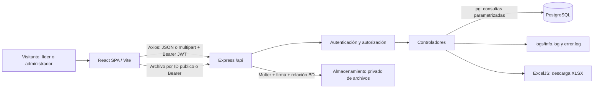
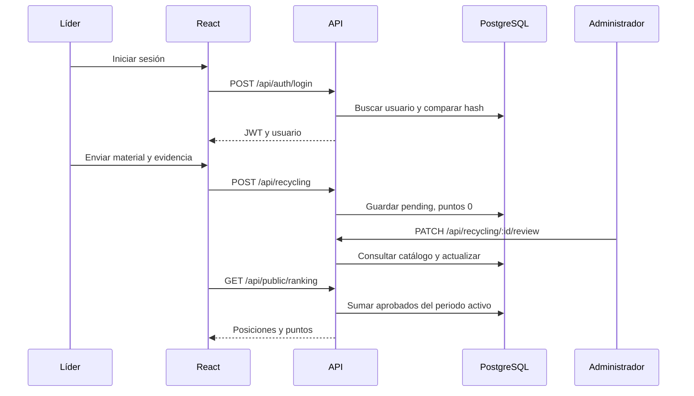

# Arquitectura e inventario

[Índice](00-INDICE.md)

## Componentes y comunicación

SPA cliente sin renderizado en servidor, API REST sin ORM y almacenamiento local de archivos. Hay pruebas acotadas de instalación en backend/tests/installation.test.js, sin script npm. No hay colas, WebSockets, servicios programados, microservicios, contenedores ni configuración CI/CD en el repositorio revisado. Premios y ganadores no forman parte de la aplicación actual.

`frontend/src/main.jsx` monta React StrictMode, ToastProvider y App. App monta AuthProvider, BrowserRouter y rutas. El layout incluye cabecera institucional y Outlet. Las rutas privadas atraviesan ProtectedRoute; la API repite la autorización en middleware.

## Dependencias declaradas

| Paquete | Rango | Uso |
| --- | --- | --- |
| react, react-dom | ^18.3.1 | Interfaz y montaje |
| react-router-dom | ^6.23.1 | BrowserRouter, rutas, navegación |
| axios | ^1.7.2 | Cliente API e interceptor Bearer |
| vite | ^8.0.8 | Desarrollo y build |
| @vitejs/plugin-react | ^4.3.1 | Transformación React |
| express | ^4.19.2 | Servidor HTTP |
| cors | ^2.8.5 | Política de origen |
| dotenv | ^16.4.5 | Lectura de `.env` |
| pg | ^8.12.0 | Pool PostgreSQL |
| bcrypt | ^5.1.1 | Hash de contraseñas |
| jsonwebtoken | ^9.0.2 | JWT |
| multer | ^1.4.5-lts.1 | Carga de archivos |
| exceljs | ^4.4.0 | Exportación; declarado también en raíz |
| nodemon | ^3.1.0 | Reinicio backend en desarrollo |

Estas son versiones solicitadas, no necesariamente las instaladas. Cada lockfile registra sus versiones resueltas y transitivas.

## Archivos raíz y base de datos

| Ruta | Responsabilidad |
| --- | --- |
| `README.md`, `docs/` | Documentación y SQL de referencia |
| `.gitignore` | Exclusión de dependencias, entorno, build, logs, uploads y respaldos |
| `package.json`, `package-lock.json` | Paquete raíz, con ExcelJS; sin scripts ni workspaces |
| `6.png`, `ManobiMesa de trabajo.png`, `ManobiMesa de trabajo 1.png`, `ManobiMesa de trabajo 2.png` | Recursos gráficos raíz, sin imports encontrados en la aplicación |
| `database/schema.sql` | Único esquema oficial para base vacía, sin datos de negocio |
| `database/points_catalog_clean.csv` | 56 acciones históricas en cuatro grupos |
| `database/import_points_catalog.sql` | Importación relativa, transaccional, repetible y sin sobrescrituras |
| `backend/schema.sql` | Entrada psql que remite al esquema oficial |

## Inventario backend

| Ruta dentro de `backend/` | Responsabilidad |
| --- | --- |
| `package.json`, `package-lock.json` | Dependencias; scripts `dev` y `start` |
| `.env.example` | Plantilla sin secretos funcionales |
| `src/server.js` | CORS, JSON, estáticos, montaje de rutas, raíz HTTP y escucha |
| `src/config/db.js` | Pool PostgreSQL y función `query(text, params)` |
| `src/routes/authRoutes.js` | Login y sesión actual |
| `src/routes/publicRoutes.js` | Ranking, estadísticas, catálogo y categorías |
| `src/routes/recyclingRoutes.js` | Crear, historial personal, pendientes, revisados y revisión |
| `src/routes/adminRoutes.js` | Gestión y exportación; Multer de contenidos |
| `src/controllers/authController.js` | bcrypt, JWT, usuario y logging de acceso |
| `src/controllers/publicController.js` | Agregaciones públicas y contenido publicado |
| `src/controllers/recyclingController.js` | Normalización, registros, catálogo y revisión |
| `src/controllers/adminController.js` | Dashboard, creación/listado de usuarios, equipos, periodos y CRUD de contenidos |
| `src/controllers/exportController.js` | Generación del archivo XLSX |
| `src/middleware/authMiddleware.js` | Firma de token y lista de roles permitidos |
| `src/middleware/uploadMiddleware.js` | Evidencias; carpeta, nombres, filtro y límite |
| `src/utils/logger.js` | Escritura síncrona a logs locales |
| `src/seed.sql` | Aviso sin escrituras: no hay datos predeterminados |
| `uploads/`, `uploads/content/`, `logs/` | Datos generados, no código distribuido |

## Inventario frontend

| Ruta dentro de `frontend/` | Responsabilidad |
| --- | --- |
| `index.html` | Idioma español, viewport, título y fuentes Google |
| `package.json`, `package-lock.json` | Dependencias y scripts `dev`, `build`, `preview` |
| `vite.config.js` | Plugin React y puerto 5173; no proxy ni base de subdirectorio |
| `.env.example` | URL pública de API |
| `src/main.jsx` | Montaje e importación ordenada de CSS |
| `src/App.jsx` | Árbol de rutas y proveedor de autenticación |
| `src/App.jx` | Archivo vacío, no utilizado |
| `src/api/client.js` | Axios, token y conversión de rutas de archivos a URLs |
| `src/context/AuthContext.jsx` | Usuario, carga, login y logout |
| `src/context/ToastContext.jsx` | Aviso temporal de 3500 ms |
| `src/components/ProtectedRoute.jsx` | Espera de sesión y redirección por rol |
| `src/components/Navbar.jsx` | Navegación antigua; no la importa el árbol activo |
| `src/layouts/AppLayout.jsx` | Cabecera, logo, sesión, enlaces y Outlet |
| `src/pages/public/HomePage.jsx` | Portada, educación ambiental y aliados |
| `src/pages/public/EducationCategoryPage.jsx` | Introducciones, consulta por categoría y modal |
| `src/pages/public/RankingPage.jsx` | Periodo, podio y tabla |
| `src/pages/auth/LoginPage.jsx` | Formulario y redirección por rol |
| `src/pages/leader/LeaderDashboard.jsx` | Historial personal y resumen del equipo |
| `src/pages/leader/RegisterRecyclingPage.jsx` | Formulario multipart y referencia de catálogo |
| `src/pages/admin/AdminDashboard.jsx` | Indicadores, gráficos CSS, accesos y descarga XLSX |
| `src/pages/admin/AdminUsersPage.jsx` | Altas, cupo visual de 15 y listado |
| `src/pages/admin/AdminReviewsPage.jsx` | Pendientes, búsqueda, filtros y revisión |
| `src/pages/admin/AdminContentPage.jsx` | Alta, edición, borrador/publicación y eliminación |
| `src/pages/admin/AdminSettingsPage.jsx` | Equipos y periodos del ranking |
| `src/styles/global.css` | Bases y componentes compartidos |
| `src/styles/pages.css` | Estilos extraídos de portada y layout |
| `src/styles/refinements.css` | Refinamientos, estados de foco y responsive |
| `src/assets/parques-logo.png`, `cleoecoamigos.png` | Logo y mascota |
| `src/assets/icons/{agua,energia,papel,residuos}.png` | Iconos de las cuatro categorías |
| `src/assets/allies/` | Logos Carvajal, ASOBOSUR, Carlos Portela y Grupo Retorna |
| `src/assets/desktop.ini` | Metadatos Windows previamente versionados; no recurso web |
| `dist/` | Build generado, excluido de Git |

## Flujo principal

El archivo se escribe antes del INSERT: si falla la base, puede quedar huérfano. La revisión no usa una transacción ni bloqueo; el detalle está en [pendientes](09-CALIDAD-Y-PENDIENTES.md).

## Autenticación y sesión — S01–S03

El JWT es identidad mínima (id, sv, iat, exp), HS256 y ocho horas. authenticateToken verifica firma/expiración y consulta una vez users/teams; comprueba existencia, is_active y session_version. req.user solo contiene datos actuales públicos. authorizeRoles y controladores usan esa autoridad; /me la reutiliza. No hay caché de permisos. Los cambios confirmados antes de la consulta se reflejan en el siguiente request; no se promete cancelar solicitudes ya autorizadas en curso. React conserva user en memoria para interfaz, nunca como autoridad del servidor.

La columna session_version permite revocar JWT después del reset sin almacenar tokens ni hashes adicionales. F16 incrementa la versión al actualizar la contraseña, en su transacción existente. Se eligió versionado porque consultar is_active/role/team no revoca una sesión de una cuenta que sigue activa después de reset. No se añadieron dependencias. La migración incremental y su verificación están en database; solo fueron ejecutadas en clústeres temporales.

S02 conserva provisionalmente Bearer/localStorage, sin cookies ni duplicación. Los orígenes CORS se configuran explícitamente y credentials permanece false. S03 limita por IP y endpoint en memoria y normaliza errores de autenticación/errores propagados. Los detalles de límites y despliegue están en 08-OPERACION; comparación de alternativas y riesgo XSS pendiente en 09-CALIDAD-Y-PENDIENTES.

## Flujo de archivos S04–S07

Multer recibe un archivo acotado en almacenamiento privado; el servidor genera UUID y abre con wx. Un worker limitado a 10 segundos/64 MiB de heap ejecuta file-type y comprobaciones básicas de cierre. Solo después se invoca el controlador para asociar el URL interno a la fila. El nombre original no se persiste como ruta. Los archivos publicados también permanecen fuera de express.static: la API decide acceso por ID y estado de la fila.

fileStore centraliza resolución de rutas, verificación de destino real y limpieza con consulta de referencias. contentFiles serializa edición/eliminación con FOR UPDATE y retira el archivo anterior después del COMMIT. Las evidencias conservan el ciclo transaccional F10 y no tienen edición/eliminación nueva. ProtectedFile obtiene Blob mediante Axios/Bearer, cancela peticiones y revoca object URLs. No hay tokens en query ni migración a cookies.
