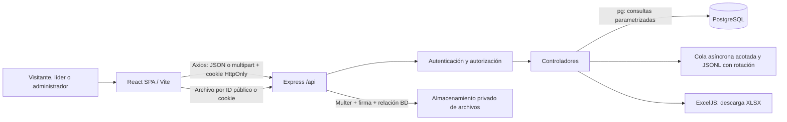
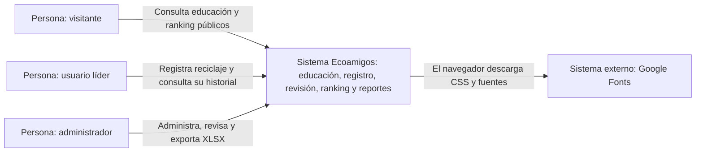
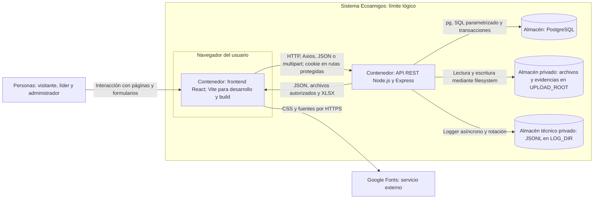
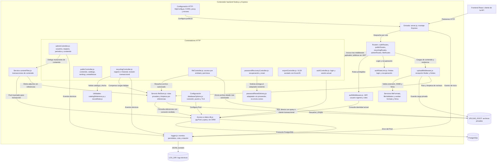
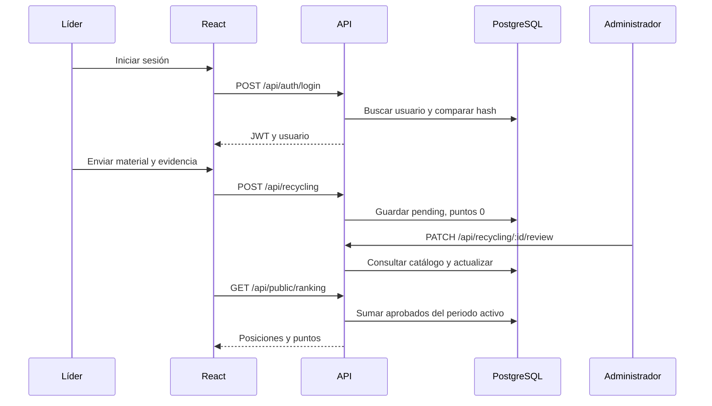

# Arquitectura e inventario

[Índice](00-INDICE.md)

## Componentes y comunicación

SPA cliente sin renderizado en servidor, API REST sin ORM y almacenamiento local de archivos. Hay suites backend/frontend con scripts npm y PostgreSQL temporal. No hay colas de trabajos externas, WebSockets, servicios programados, microservicios ni contenedores de aplicación. CI sí usa un service container PostgreSQL; no hay despliegue automatizado. El workflow .github/workflows/ci.yml incorpora integración continua. Premios y ganadores no forman parte de la aplicación actual.

`frontend/src/main.jsx` monta React StrictMode, ToastProvider y App. App monta AuthProvider, BrowserRouter y rutas. El layout incluye cabecera institucional y Outlet. Las rutas privadas atraviesan ProtectedRoute; la API repite la autorización en middleware.

## Modelo C4

Estas vistas describen la arquitectura lógica inspeccionada en el repositorio sobre f21b2a6 y complementan el inventario y los flujos de este documento. Se usa Mermaid flowchart con etiquetas de responsabilidad para expresar C4 niveles 1–3, sin macros C4 experimentales. Las flechas indican uso o dependencia, no despliegue físico. Un **contenedor C4** es una aplicación o almacén de datos: no implica Docker. No existe infraestructura institucional de producción desplegada.

### C4 nivel 1 — Contexto de Ecoamigos

Propósito: delimitar el sistema, las personas que lo usan y sus relaciones externas reales. Visitante es una persona sin sesión, no un rol persistido; leader y admin sí son roles de la aplicación.

Ecoamigos incluye su persistencia PostgreSQL y almacenamiento de archivos/evidencias; se abren en el nivel 2, no se presentan como sistemas de negocio externos independientes. Google Fonts está referenciado en frontend/index.html. Los enlaces a aliados en HomePage.jsx son navegación a sitios externos, sin integración API ni intercambio de registros. La recuperación contiene un adaptador sin proveedor: **Integración futura / pendiente de configuración institucional**; no hay entrega real de correo y no se dibuja como conexión activa. Fuentes locales: frontend/src/App.jsx, páginas públicas y backend/src/server.js.

### C4 nivel 2 — Contenedores de ejecución

Propósito: mostrar dónde se ejecutan la interfaz y la lógica, y qué almacenes utiliza la API. El navegador es el entorno de ejecución del frontend, no una aplicación adicional que sustituya la SPA.

React ofrece navegación, formularios y estados de sesión; Vite sirve desarrollo y genera frontend/dist, no ejecuta el backend. Express aplica autorización, reglas y acceso por entidad a archivos; PostgreSQL conserva usuarios, períodos, catálogo y registros. UPLOAD_ROOT conserva adjuntos y LOG_DIR los eventos técnicos, sin publicación general de /uploads. Son ubicaciones lógicas, no volúmenes o servidores institucionales ya provisionados. HTTP describe el intercambio local; dominios, HTTPS, proxy y hosting futuro siguen por definir. No hay ORM ni microservicios. Referencias: frontend/src/api/client.js, backend/src/config/db.js, services/fileStore.js y utils/logger.js.

### C4 nivel 3 — Componentes del contenedor backend

Propósito: abrir la API Express en los módulos reales de entrada, seguridad, controladores, servicios y utilidades. Las agrupaciones corresponden a carpetas y responsabilidades existentes; no añaden una capa de repositorios ni un servicio de negocio universal.

Los routers seleccionan middleware según endpoint: no toda petición requiere JWT, límite auth o upload. authMiddleware consulta la identidad actual; los controladores ejecutan SQL directamente o reciben conexiones para transacciones. contentFiles recibe el Pool y fileStore recibe acceso a consultas para comprobar referencias; sus flechas no representan conexiones independientes. fileController resuelve permisos en BD antes de enviar el archivo. El worker de validación no es un servicio desplegado aparte ni antivirus. El controlador XLSX genera la respuesta HTTP usando ExcelJS; no hay cola de exportación externa. Las flechas a logger ilustran consumidores reales, no una auditoría inmutable ni un registro de todas las peticiones. El inventario siguiente localiza cada módulo; [API](04-API.md) y [reglas](06-REGLAS-Y-BACKEND.md) contienen los contratos completos.

No se añade nivel 4: el inventario por archivo y el diagrama de secuencia ya permiten seguir la implementación sin duplicar clases o funciones para completar un nivel.

### Vista complementaria — CI, fuera del modelo funcional

GitHub Actions ejecuta el workflow ante push o pull_request hacia main. El job quality instala con npm ci, verifica un servicio PostgreSQL efímero y usa además clústeres aislados para las suites; después ejecuta pruebas backend/frontend, build y checks. dependency-audit es un job separado: instala sin scripts, ejecuta cuatro auditorías y publica riesgos, resumen y artifacts; no es una etapa obligatoriamente posterior a quality. Se conserva así el orden y la independencia reales de .github/workflows/ci.yml.

**CI IMPLEMENTADO Y VALIDADO**, con f21b2a6 SUCCESS informado por el usuario. No existe CD ni deploy automático. GitHub Actions, el contenedor PostgreSQL del runner y sus clústeres temporales son infraestructura de calidad; no son contenedores funcionales del sistema ni una instalación institucional. Detalles y procedencia: [operación](08-OPERACION.md) y [primer run y cierre posterior](14-CI-PRIMER-RUN.md).

## Dependencias declaradas

| Paquete | Rango | Uso |
| --- | --- | --- |
| react, react-dom | ^18.3.1 | Interfaz y montaje |
| react-router-dom | ^6.23.1 | BrowserRouter, rutas, navegación |
| axios | ^1.7.2 | Cliente API con credentials y cabecera CSRF |
| vite | ^8.0.8 | Desarrollo y build |
| @vitejs/plugin-react | 5.2.0 | Transformación React |
| express | ^4.19.2 | Servidor HTTP |
| cors | ^2.8.5 | Política de origen |
| dotenv | ^16.4.5 | Lectura de `.env` |
| pg | ^8.12.0 | Pool PostgreSQL |
| bcrypt | ^5.1.1 | Hash de contraseñas |
| jsonwebtoken | ^9.0.2 | JWT |
| multer | ^1.4.5-lts.1 | Carga de archivos |
| exceljs | ^4.4.0 | Exportación; declarado también en raíz |
| nodemon | ^3.1.0 | Reinicio backend en desarrollo |

Estas son versiones solicitadas, no necesariamente las instaladas. Cada lockfile registra sus versiones resueltas y transitivas.

## Archivos raíz y base de datos

| Ruta | Responsabilidad |
| --- | --- |
| `README.md`, `docs/` | Documentación y SQL de referencia |
| `.gitignore` | Exclusión de dependencias, entorno, build, logs, uploads y respaldos |
| `package.json`, `package-lock.json` | Paquete raíz con ExcelJS redundante; scripts test/test:ci/check/build, sin workspaces |
| `6.png`, `ManobiMesa de trabajo.png`, `ManobiMesa de trabajo 1.png`, `ManobiMesa de trabajo 2.png` | Recursos gráficos raíz, sin imports encontrados en la aplicación |
| `database/schema.sql` | Único esquema oficial para base vacía, sin datos de negocio |
| `database/points_catalog_clean.csv` | 56 acciones históricas en cuatro grupos |
| `database/import_points_catalog.sql` | Importación relativa, transaccional, repetible y sin sobrescrituras |
| `backend/schema.sql` | Entrada psql que remite al esquema oficial |

## Inventario backend

| Ruta dentro de `backend/` | Responsabilidad |
| --- | --- |
| `package.json`, `package-lock.json` | Dependencias; scripts dev/start/test/test:ci |
| `.env.example` | Plantilla sin secretos funcionales |
| `src/server.js` | CORS, JSON, archivos por entidad, montaje de rutas, raíz HTTP y escucha |
| `src/config/db.js` | Pool único y función query; consume databaseOptions.js sin duplicar configuración |
| `src/config/databaseOptions.js` | Constructor puro de configuración DB local/URL/SSL, comprobable sin red |
| `src/routes/authRoutes.js` | Login, sesión actual y recuperación con límites por endpoint |
| `src/routes/publicRoutes.js` | Ranking, estadísticas, catálogo y categorías |
| `src/routes/recyclingRoutes.js` | Crear, historial personal, pendientes, revisados y revisión |
| `src/routes/adminRoutes.js` | Gestión, edición permitida y exportación; middleware de contenidos |
| `src/controllers/authController.js` | bcrypt, JWT, usuario y logging de acceso |
| `src/controllers/publicController.js` | Agregaciones públicas y contenido publicado |
| `src/controllers/recyclingController.js` | Normalización, registros, catálogo y revisión |
| `src/controllers/adminController.js` | Dashboard, alta/listado de usuarios/equipos/períodos, edición F15 y delegación del CRUD de contenidos |
| `src/controllers/exportController.js` | Generación del archivo XLSX |
| `src/middleware/authMiddleware.js` | Verificación JWT, usuario/estado/versión actual en BD y roles permitidos |
| `src/middleware/uploadMiddleware.js` | Cargas de contenido/evidencias, límites, nombres y validación |
| `src/utils/logger.js` | Eventos técnicos JSONL asíncronos, minimizados y rotados |
| `src/routes/fileRoutes.js`, `src/controllers/fileController.js` | Acceso a archivos por entidad/permisos |
| `src/controllers/passwordRecoveryController.js`, `src/services/passwordResetDelivery.js` | Recuperación y adaptador sin proveedor |
| `src/services/contentFiles.js`, `fileStore.js`, `fileFormats.js`, `fileValidation.js`, `fileValidationWorker.js` | Transacciones de contenido, almacenamiento privado y validación |
| `src/middleware/authRateLimit.js`, `httpConfig.js` | Límites auth, CORS/proxy y errores propagados |
| `src/utils/catalogReference.js`, `recordDate.js` | Validación de referencia y fecha |
| `tests/`, `scripts/hash-password.js`, `scripts/measure-export.mjs` | Verificación, bootstrap y medición sintética |
| `src/seed.sql` | Aviso sin escrituras: no hay datos predeterminados |
| UPLOAD_ROOT y LOG_DIR; por defecto uploads/ y logs/ | Datos privados generados; managed/content y managed/evidence para cargas nuevas; rutas heredadas compatibles |

## Inventario frontend

| Ruta dentro de `frontend/` | Responsabilidad |
| --- | --- |
| `index.html` | Idioma español, viewport, título y fuentes Google |
| `package.json`, `package-lock.json` | Dependencias y scripts dev/build/preview/test/test:ci |
| `vite.config.js` | Plugin React y puerto 5173; no proxy ni base de subdirectorio |
| `.env.example` | URL pública de API |
| `src/components/LoadState.jsx`, `ProtectedFile.jsx` | Estado de carga y archivos protegidos |
| `src/pages/public/NotFoundPage.jsx`, `src/pages/auth/PasswordRecoveryPage.jsx` | 404 y recuperación |
| `src/api/session.js`, `src/utils/uiError.js`, `exportError.js`, `dialogFocus.js` | Sesión y helpers de interacción |
| `tests/` | Pruebas frontend; host DOM mínimo, no certificación visual |
| `src/main.jsx` | Montaje e importación ordenada de CSS |
| `src/App.jsx` | Árbol de rutas y proveedor de autenticación |
| `src/App.jx` | Archivo vacío, no utilizado |
| `src/api/client.js` | Axios, token y conversión de rutas de archivos a URLs |
| `src/context/AuthContext.jsx` | Usuario, carga, login y logout |
| `src/context/ToastContext.jsx` | Aviso temporal de 3500 ms |
| `src/components/ProtectedRoute.jsx` | Espera de sesión y redirección por rol |
| `src/components/Navbar.jsx` | Navegación antigua; no la importa el árbol activo |
| `src/layouts/AppLayout.jsx` | Cabecera, logo, sesión, enlaces y Outlet |
| `src/pages/public/HomePage.jsx` | Portada, educación ambiental y aliados |
| `src/pages/public/EducationCategoryPage.jsx` | Introducciones, consulta por categoría y modal |
| `src/pages/public/RankingPage.jsx` | Periodo, podio y tabla |
| `src/pages/auth/LoginPage.jsx` | Formulario y redirección por rol |
| `src/pages/leader/LeaderDashboard.jsx` | Historial personal y resumen del equipo |
| `src/pages/leader/RegisterRecyclingPage.jsx` | Formulario multipart y referencia de catálogo |
| `src/pages/admin/AdminDashboard.jsx` | Indicadores, gráficos CSS, accesos y descarga XLSX |
| `src/pages/admin/AdminUsersPage.jsx` | Alta/listado/edición/estado de cuentas, cupo de 15 |
| `src/pages/admin/AdminReviewsPage.jsx` | Pendientes, búsqueda, filtros y revisión |
| `src/pages/admin/AdminContentPage.jsx` | Alta, edición, borrador/publicación y eliminación |
| `src/pages/admin/AdminSettingsPage.jsx` | Equipos y periodos del ranking |
| `src/styles/global.css` | Bases y componentes compartidos |
| `src/styles/pages.css` | Estilos extraídos de portada y layout |
| `src/styles/refinements.css` | Refinamientos, estados de foco y responsive |
| `src/assets/parques-logo.png`, `cleoecoamigos.png` | Logo y mascota |
| `src/assets/icons/{agua,energia,papel,residuos}.png` | Iconos de las cuatro categorías |
| `src/assets/allies/` | Logos Carvajal, ASOBOSUR, Carlos Portela y Grupo Retorna |
| `src/assets/desktop.ini` | Metadatos Windows previamente versionados; no recurso web |
| `dist/` | Build generado, excluido de Git |

## Flujo principal

La revisión usa transacción y bloqueo de fila: solo pending → approved/rejected. F09/F10 coordinan períodos y registros mediante bloqueos de tabla. S06 compensa archivos nuevos ante fallo y limpia reemplazados después del COMMIT si no hay referencias; una caída abrupta aún puede dejar residuos porque disco y BD no son una transacción distribuida.

## Autenticación y sesión — S01–S03

El JWT es identidad mínima (id, sv, iat, exp), HS256 y ocho horas. authenticateToken verifica firma/expiración y consulta una vez users/teams; comprueba existencia, is_active y session_version. req.user solo contiene datos actuales públicos. authorizeRoles y controladores usan esa autoridad; /me la reutiliza. No hay caché de permisos. Los cambios confirmados antes de la consulta se reflejan en el siguiente request; no se promete cancelar solicitudes ya autorizadas en curso. React conserva user en memoria para interfaz, nunca como autoridad del servidor.

La columna session_version permite revocar JWT después del reset sin almacenar tokens ni hashes adicionales. F16 incrementa la versión al actualizar la contraseña, en su transacción existente. Se eligió versionado porque consultar is_active/role/team no revoca una sesión de una cuenta que sigue activa después de reset. No se añadieron dependencias. La migración incremental y su verificación están en database; también cuentan con aplicación/verificación en desarrollo/QA local informada por el responsable; no en producción institucional.

Sesión S02: JWT HS256 de ocho horas en cookie ecoamigos_session, HttpOnly, SameSite=Lax, Path=/api, sin Domain; Secure cuando NODE_ENV=production. El body de login ya no contiene JWT. Frontend y API deben compartir sitio y esquema (localhost con distintos puertos en desarrollo; HTTPS bajo el mismo sitio en producción). No se soporta automáticamente un frontend en un sitio distinto; no cambiar a SameSite=None sin revisar despliegue y pruebas. CLIENT_URL es el único origen permitido para CORS y CSRF. Fuera de producción, si falta, se usa http://localhost:5173; en producción es obligatorio un origen HTTPS exacto. No se admiten wildcard, lista, ruta, credenciales ni slash final. CORS_ORIGINS es una variable heredada: retirarla o mantenerla idéntica a CLIENT_URL; otro valor detiene el arranque. Axios y CORS habilitan credenciales. Los métodos mutantes exigen Origin igual a CLIENT_URL y X-Ecoamigos-Request: 1, incluso login, logout y recuperación.

## Flujo de archivos S04–S07

Multer recibe un archivo acotado en almacenamiento privado; el servidor genera UUID y abre con wx. Un worker limitado a 10 segundos/64 MiB de heap ejecuta file-type y comprobaciones básicas de cierre. Solo después se invoca el controlador para asociar el URL interno a la fila. El nombre original no se persiste como ruta. Los archivos publicados también permanecen fuera de express.static: la API decide acceso por ID y estado de la fila.

fileStore centraliza resolución de rutas, verificación de destino real y limpieza con consulta de referencias. contentFiles serializa edición/eliminación con FOR UPDATE y retira el archivo anterior después del COMMIT. Las evidencias conservan el ciclo transaccional F10 y no tienen edición/eliminación nueva. ProtectedFile obtiene Blob mediante Axios/cookie, cancela peticiones y revoca object URLs. No hay tokens en query; la sesión usa cookie HttpOnly.

S11: el controlador de exportación conserva ExcelJS Workbook en memoria, pero la consulta está limitada a EXPORT_MAX_ROWS + 1 y se rechaza el exceso antes de construir el libro. Exclusión de una generación simultánea por proceso; sin cola distribuida. S12: scripts/run-tests.mjs aísla el entorno de pruebas; scripts/check.mjs valida sintaxis, YAML y diff. yaml 2.9.1 es dependencia de desarrollo backend exclusiva de esas verificaciones.

### Actualización S02 — 2026-09-30

Sesión S02: JWT HS256 de ocho horas en cookie ecoamigos_session, HttpOnly, SameSite=Lax, Path=/api, sin Domain; Secure cuando NODE_ENV=production. El body de login ya no contiene JWT. Frontend y API deben compartir sitio y esquema (localhost con distintos puertos en desarrollo; HTTPS bajo el mismo sitio en producción). No se soporta automáticamente un frontend en un sitio distinto; no cambiar a SameSite=None sin revisar despliegue y pruebas. CLIENT_URL es el único origen permitido para CORS y CSRF. Fuera de producción, si falta, se usa http://localhost:5173; en producción es obligatorio un origen HTTPS exacto. No se admiten wildcard, lista, ruta, credenciales ni slash final. CORS_ORIGINS es una variable heredada: retirarla o mantenerla idéntica a CLIENT_URL; otro valor detiene el arranque. Axios y CORS habilitan credenciales. Los métodos mutantes exigen Origin igual a CLIENT_URL y X-Ecoamigos-Request: 1, incluso login, logout y recuperación. Logout no cambia las reglas de revocación S01: reset incrementa session_version y las peticiones siguientes rechazan cualquier JWT anterior. Se conservan autorización y límites S03. Ver evidencia de pruebas y decisión CSRF en [09](09-CALIDAD-Y-PENDIENTES.md).
