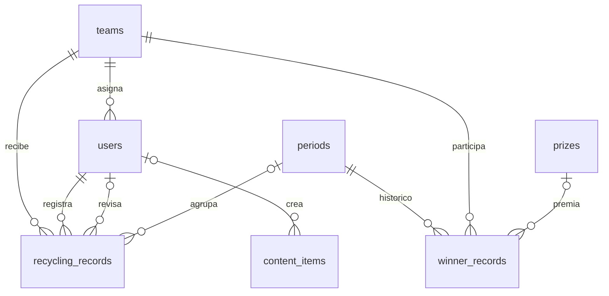

# Base de datos y diccionario

[Índice](00-INDICE.md)

## Fuentes y estado

El único esquema oficial es [database/schema.sql](../database/schema.sql), para bases vacías. backend/schema.sql y docs/sql/schema-referencia.sql remiten a él con \ir; no contienen otra definición. El alta de usuarios almacena solo password_hash. El catálogo usa evidencia descriptiva e identidad normalizada única. No se suministran datos de negocio ni credenciales por defecto.

Una base existente no se migra automáticamente: consultar [procedimiento de conciliación](../database/README.md) y el diagnóstico de solo lectura. No ejecutar CREATE TABLE para actualizar columnas ni mezclar el esquema con versiones históricas.

## Relaciones del esquema oficial



La asignación de equipo a usuario es opcional. `points_catalog` no tiene FK con los registros: se enlaza por tres textos en el momento de aprobar. `winner_records` permanece en el SQL histórico, pero la API actual no la consulta.

## Diccionario completo

`SERIAL` significa entero autoincremental con clave primaria. Las fechas de creación son `TIMESTAMP` sin zona horaria. Ver el esquema oficial para las restricciones exactas.

### teams

| Campo | Tipo | Regla / uso |
| --- | --- | --- |
| id | SERIAL | Identificador |
| name | VARCHAR(100) | Obligatorio y único en esquema backend |
| dependency | VARCHAR(150) | Obligatorio |
| created_at | TIMESTAMP | NOW() |

### users

| Campo | Tipo | Regla / uso |
| --- | --- | --- |
| id | SERIAL | Identificador |
| name | VARCHAR(120) | Obligatorio |
| email | VARCHAR(150) | Obligatorio, único; código no normaliza mayúsculas |
| password_hash | TEXT | Hash bcrypt requerido por login |
| role | user_role | `admin` o `leader` |
| team_id | INT, nullable | FK teams; ON DELETE SET NULL |
| is_active | BOOLEAN | Por defecto true; comprobado al iniciar sesión |
| created_at | TIMESTAMP | NOW() |

### periods

| Campo | Tipo | Regla / uso |
| --- | --- | --- |
| id | SERIAL | Identificador |
| name | VARCHAR(120) | Obligatorio, único |
| start_date, end_date | DATE | Obligatorios; código no impone orden cronológico |
| is_active | BOOLEAN | Por defecto false en SQL backend; UI inicia true |
| created_at | TIMESTAMP | NOW() |

F09 garantiza **máximo un período activo**, permitiendo cero, con `CREATE UNIQUE INDEX periods_one_active_uidx ON public.periods (is_active) WHERE is_active = true`. Protege tanto INSERT como UPDATE, incluso fuera del backend. La creación activa desactiva los anteriores e inserta dentro de una transacción con bloqueo de escritores; los lectores siguen viendo el estado confirmado.

La instalación nueva y la migración D01 actualizada incluyen ese índice. Para una instalación que ya ejecutó D01 antes de F09, se preparó [20260909_f09_periods_one_active.sql](../database/20260909_f09_periods_one_active.sql): aplicar una sola vez con psql y ON_ERROR_STOP, sin volver a ejecutar D01. Bloquea escritores, detecta varios activos y aborta sin elegir ninguno ni cambiar filas. Cero activos es válido. Si el índice ya existe, el script falla de forma segura; no omite silenciosamente un índice homónimo de definición desconocida. No se ejecutó sobre la base real.

### content_items

| Campo | Tipo | Regla / uso |
| --- | --- | --- |
| id | SERIAL | Identificador |
| title | VARCHAR(180) | Obligatorio |
| category | VARCHAR(30) | `agua`, `energia`, `papel`, `residuos` |
| type | VARCHAR(20) | `text`, `image`, `video`, `file` |
| description | TEXT | Texto y descripción; nullable |
| youtube_url | TEXT | Histórico, no lo lee/escribe el controlador actual |
| file_url | TEXT | `/uploads/content/...`; nullable |
| status | VARCHAR(20) | `draft` o `published`; por defecto published |
| created_by | INT, nullable | FK users; ON DELETE SET NULL |
| created_at | TIMESTAMP | NOW() |

### prizes — legado conservado

La aplicación actual no consulta ni administra esta tabla. Se mantiene sin cambios para preservar historia y posibles dependencias externas hasta autorizar una limpieza física posterior.

| Campo | Tipo | Regla / uso |
| --- | --- | --- |
| id | SERIAL | Identificador |
| name | VARCHAR(150) | Obligatorio |
| description | TEXT | Nullable |
| is_active | BOOLEAN | Por defecto true; sin uso en la API actual |
| created_at | TIMESTAMP | NOW() |

### recycling_records

| Campo | Tipo | Regla / uso |
| --- | --- | --- |
| id | SERIAL | Identificador |
| user_id | INT | FK users obligatoria; ON DELETE CASCADE |
| team_id | INT | FK teams obligatoria; ON DELETE CASCADE |
| period_id | INT, nullable | FK periods; ON DELETE SET NULL |
| material_type | VARCHAR(30) | papel_carton, plastico, vidrio, metal, organico |
| quantity | NUMERIC(10,2) | Mayor que cero |
| unit | VARCHAR(20) | Obligatorio, por defecto kg; formulario permite editar libremente |
| quality_level | VARCHAR(10) | alta, media, baja |
| criteria_count | INT | >= 0; por defecto 0; SQL no limita máximo a 5 |
| notes | TEXT | Observación del líder; nullable |
| evidence_url | TEXT | Ruta de archivo; nullable |
| record_date | DATE | Fecha declarada; por defecto CURRENT_DATE |
| status | record_status | pending, approved, rejected |
| review_notes | TEXT | Comentario administrativo; nullable |
| points_awarded | INT | Por defecto 0; fijado en revisión |
| reviewed_by | INT, nullable | FK users; ON DELETE SET NULL |
| reviewed_at | TIMESTAMP | Fecha de última revisión; nullable |
| created_at | TIMESTAMP | NOW() |
| catalog_group_name | VARCHAR(100) | Identidad canónica validada contra points_catalog al crear; nullable por compatibilidad histórica |
| catalog_action_name | VARCHAR(150) | Identidad canónica validada contra points_catalog al crear; nullable por compatibilidad histórica |
| catalog_action_level | VARCHAR(100) | Identidad canónica validada contra points_catalog al crear; nullable por compatibilidad histórica |

### points_catalog

| Campo | Tipo | Regla / uso |
| --- | --- | --- |
| id | SERIAL | Identificador; índice único evita identidades normalizadas repetidas en la base nueva |
| source_code | VARCHAR(50) | Identificador textual de origen |
| group_name | VARCHAR(100) | Obligatorio |
| action_name | VARCHAR(150) | Obligatorio |
| action_level | VARCHAR(100) | Nullable; null equivale a texto vacío en búsqueda |
| points | INT | Por defecto 0; API devuelve número |
| evidence_required | TEXT | Instrucciones originales del CSV; no se convierten a booleano ni se validan automáticamente |
| max_frequency | VARCHAR(50) | Texto informativo; no hay contador ni restricción automática |

El CSV contiene 56 filas distribuidas en `Hogares`, `Inst. Educativas`, `Comunitario`, `Senderos PNN`. No incluye `Dependencias institucionales`. No convertir arbitrariamente grupos ni asumir que sus puntos son institucionales.

### winner_records — legado

`id SERIAL`, `period_id INT NOT NULL` FK periods CASCADE, `team_id INT NOT NULL` FK teams CASCADE, `prize_id INT` FK prizes SET NULL, `final_score INT NOT NULL`, `created_at TIMESTAMP DEFAULT NOW()`, UNIQUE(period_id, team_id). No hay endpoint para registrar ni cerrar ganadores. Se conserva temporalmente por compatibilidad; fuera del alcance de producto, sin seed ni retirada automática.

## Inspección y consultas útiles

En `psql`:

```sql
\dt
\d users
\d content_items
\d recycling_records
\d points_catalog
SELECT id, name, start_date, end_date, is_active FROM periods ORDER BY id DESC;
SELECT group_name, COUNT(*) FROM points_catalog GROUP BY group_name ORDER BY group_name;
SELECT status, COUNT(*), SUM(points_awarded) FROM recycling_records GROUP BY status;
```

Buscar duplicados que producirían una asignación ambigua:

```sql
SELECT lower(trim(group_name)), lower(trim(action_name)),
       lower(trim(coalesce(action_level, ''))), COUNT(*)
FROM points_catalog
GROUP BY 1, 2, 3 HAVING COUNT(*) > 1;
```

Detectar registros sin referencia válida:

```sql
SELECT r.id, r.catalog_group_name, r.catalog_action_name, r.catalog_action_level
FROM recycling_records r
WHERE NOT EXISTS (
  SELECT 1 FROM points_catalog c
  WHERE lower(trim(c.group_name)) = lower(trim(r.catalog_group_name))
    AND lower(trim(c.action_name)) = lower(trim(r.catalog_action_name))
    AND lower(trim(coalesce(c.action_level, ''))) = lower(trim(coalesce(r.catalog_action_level, '')))
);
```

No compartir resultados con datos personales. Respaldo y restauración: [operación](08-OPERACION.md).
