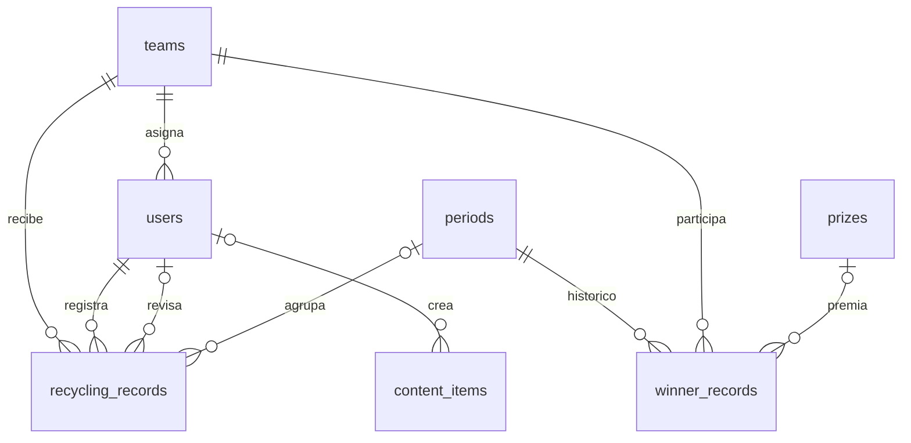

# Base de datos y diccionario

[Índice](00-INDICE.md)

## Fuentes y estado

No existe una migración autoritativa que reproduzca todo el contrato actual. El diccionario siguiente describe columnas utilizadas por el código, conservando tipos del esquema backend donde existen. Las extensiones faltantes se identifican como propuestas en [schema-referencia.sql](sql/schema-referencia.sql).

| Fuente | Diferencias respecto al código |
| --- | --- |
| `database/schema.sql` | `users` sin nombre, hash ni equipo; equipos sin dependencia; reciclaje usa `points` y carece de campos de revisión; usa `contents`/`rewards` en lugar de `content_items`/`prizes` |
| `backend/schema.sql` | Falta `users.password` que inserta createUser; falta `content_items.category`; tipos antiguos de contenido; falta catálogo y sus tres referencias en registros |
| `backend/src/seed.sql` | Hash no coincide con clave anunciada; tipos antiguos, video de demostración y periodo fijo abril 2026; no es totalmente idempotente |
| `database/import_points_catalog.sql` | Ruta absoluta local; CSV con texto donde el primer esquema espera booleano |

No ejecutar ambos esquemas uno después del otro. No usar `IF NOT EXISTS` como migración. Para conocer una base existente exportar su esquema sin datos y comparar antes de planificar cambios.

## Relaciones propuestas a partir del modelo backend



La asignación de equipo a usuario es opcional. `points_catalog` no tiene FK con los registros: se enlaza por tres textos en el momento de aprobar. `winner_records` permanece en el SQL histórico, pero la API actual no la consulta.

## Diccionario completo

`SERIAL` significa entero autoincremental con clave primaria. Las fechas de creación de los esquemas son `TIMESTAMP` sin zona horaria. Ver el SQL para restricciones exactas de la propuesta.

### teams

| Campo | Tipo | Regla / uso |
| --- | --- | --- |
| id | SERIAL | Identificador |
| name | VARCHAR(100) | Obligatorio y único en esquema backend |
| dependency | VARCHAR(150) | Obligatorio |
| created_at | TIMESTAMP | NOW() |

### users

| Campo | Tipo | Regla / uso |
| --- | --- | --- |
| id | SERIAL | Identificador |
| name | VARCHAR(120) | Obligatorio |
| email | VARCHAR(150) | Obligatorio, único; código no normaliza mayúsculas |
| password | TEXT propuesto | Hash duplicado que inserta createUser; falta en esquema backend |
| password_hash | TEXT | Hash bcrypt requerido por login |
| role | user_role | `admin` o `leader` |
| team_id | INT, nullable | FK teams; ON DELETE SET NULL |
| is_active | BOOLEAN | Por defecto true; comprobado al iniciar sesión |
| created_at | TIMESTAMP | NOW() |

### periods

| Campo | Tipo | Regla / uso |
| --- | --- | --- |
| id | SERIAL | Identificador |
| name | VARCHAR(120) | Obligatorio, único |
| start_date, end_date | DATE | Obligatorios; código no impone orden cronológico |
| is_active | BOOLEAN | Por defecto false en SQL backend; UI inicia true |
| created_at | TIMESTAMP | NOW() |

No hay índice único parcial que garantice un solo periodo activo. La creación activa desactiva otros mediante una consulta separada.

### content_items

| Campo | Tipo | Regla / uso |
| --- | --- | --- |
| id | SERIAL | Identificador |
| title | VARCHAR(180) | Obligatorio |
| category | VARCHAR(30) propuesto | `agua`, `energia`, `papel`, `residuos`; falta en esquema backend |
| type | VARCHAR(20) | UI: `text`, `image`, `video`, `file`; SQL histórico: video/tip/guide/blog |
| description | TEXT | Texto y descripción; nullable |
| youtube_url | TEXT | Histórico, no lo lee/escribe el controlador actual |
| file_url | TEXT | `/uploads/content/...`; nullable |
| status | VARCHAR(20) | `draft` o `published`; por defecto published |
| created_by | INT, nullable | FK users; ON DELETE SET NULL |
| created_at | TIMESTAMP | NOW() |

### prizes

| Campo | Tipo | Regla / uso |
| --- | --- | --- |
| id | SERIAL | Identificador |
| name | VARCHAR(150) | Obligatorio |
| description | TEXT | Nullable |
| is_active | BOOLEAN | Por defecto true; API pública no filtra esta bandera |
| created_at | TIMESTAMP | NOW() |

### recycling_records

| Campo | Tipo | Regla / uso |
| --- | --- | --- |
| id | SERIAL | Identificador |
| user_id | INT | FK users obligatoria; ON DELETE CASCADE |
| team_id | INT | FK teams obligatoria; ON DELETE CASCADE |
| period_id | INT, nullable | FK periods; ON DELETE SET NULL |
| material_type | VARCHAR(30) | papel_carton, plastico, vidrio, metal, organico |
| quantity | NUMERIC(10,2) | Mayor que cero |
| unit | VARCHAR(20) | Obligatorio, por defecto kg; formulario permite editar libremente |
| quality_level | VARCHAR(10) | alta, media, baja |
| criteria_count | INT | >= 0; por defecto 0; SQL no limita máximo a 5 |
| notes | TEXT | Observación del líder; nullable |
| evidence_url | TEXT | Ruta de archivo; nullable |
| record_date | DATE | Fecha declarada; por defecto CURRENT_DATE |
| status | record_status | pending, approved, rejected |
| review_notes | TEXT | Comentario administrativo; nullable |
| points_awarded | INT | Por defecto 0; fijado en revisión |
| reviewed_by | INT, nullable | FK users; ON DELETE SET NULL |
| reviewed_at | TIMESTAMP | Fecha de última revisión; nullable |
| created_at | TIMESTAMP | NOW() |
| catalog_group_name | VARCHAR(100) propuesto | Texto recibido del formulario; nullable |
| catalog_action_name | VARCHAR(150) propuesto | Texto recibido del formulario; nullable |
| catalog_action_level | VARCHAR(100) propuesto | Texto recibido del formulario; nullable |

### points_catalog

| Campo | Tipo | Regla / uso |
| --- | --- | --- |
| id | SERIAL | Se usa el menor id si varias filas coinciden |
| source_code | VARCHAR(50) | Identificador textual de origen |
| group_name | VARCHAR(100) | Obligatorio |
| action_name | VARCHAR(150) | Obligatorio |
| action_level | VARCHAR(100) | Nullable; null equivale a texto vacío en búsqueda |
| points | INT | Por defecto 0; API devuelve número |
| evidence_required | TEXT propuesto | CSV contiene instrucciones; primer esquema lo declara BOOLEAN |
| max_frequency | VARCHAR(50) | Texto informativo; no hay contador ni restricción automática |

El CSV contiene 56 filas distribuidas en `Hogares`, `Inst. Educativas`, `Comunitario`, `Senderos PNN`. No incluye `Dependencias institucionales`. No convertir arbitrariamente grupos ni asumir que sus puntos son institucionales.

### winner_records — legado

`id SERIAL`, `period_id INT NOT NULL` FK periods CASCADE, `team_id INT NOT NULL` FK teams CASCADE, `prize_id INT` FK prizes SET NULL, `final_score INT NOT NULL`, `created_at TIMESTAMP DEFAULT NOW()`, UNIQUE(period_id, team_id). No hay endpoint para registrar ni cerrar ganadores. Se conserva en la propuesta para reflejar el esquema histórico, no por uso actual.

## Inspección y consultas útiles

En `psql`:

```sql
\dt
\d users
\d content_items
\d recycling_records
\d points_catalog
SELECT id, name, start_date, end_date, is_active FROM periods ORDER BY id DESC;
SELECT group_name, COUNT(*) FROM points_catalog GROUP BY group_name ORDER BY group_name;
SELECT status, COUNT(*), SUM(points_awarded) FROM recycling_records GROUP BY status;
```

Buscar duplicados que producirían una asignación ambigua:

```sql
SELECT lower(trim(group_name)), lower(trim(action_name)),
       lower(trim(coalesce(action_level, ''))), COUNT(*)
FROM points_catalog
GROUP BY 1, 2, 3 HAVING COUNT(*) > 1;
```

Detectar registros sin referencia válida:

```sql
SELECT r.id, r.catalog_group_name, r.catalog_action_name, r.catalog_action_level
FROM recycling_records r
WHERE NOT EXISTS (
  SELECT 1 FROM points_catalog c
  WHERE lower(trim(c.group_name)) = lower(trim(r.catalog_group_name))
    AND lower(trim(c.action_name)) = lower(trim(r.catalog_action_name))
    AND lower(trim(coalesce(c.action_level, ''))) = lower(trim(coalesce(r.catalog_action_level, '')))
);
```

No compartir resultados con datos personales. Respaldo y restauración: [operación](08-OPERACION.md).
