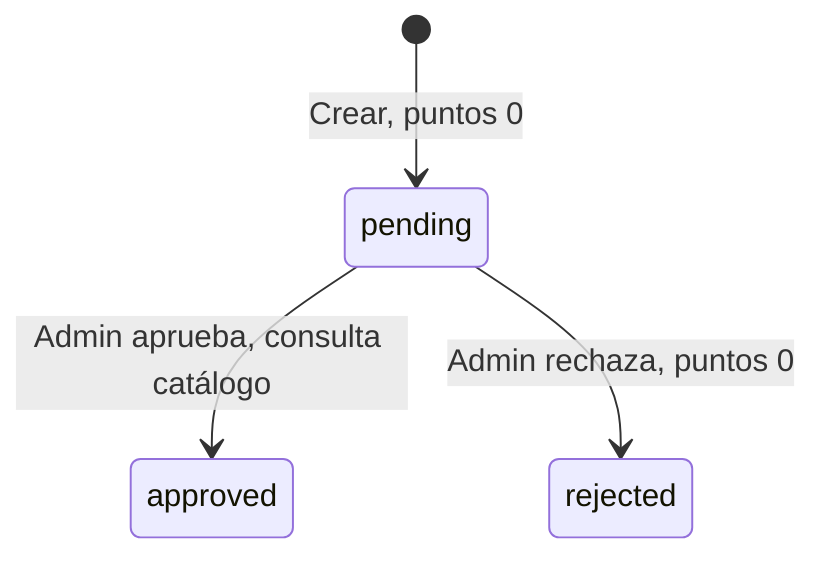

# Reglas de negocio y backend

[Índice](00-INDICE.md)

## Servidor y persistencia

Express monta CORS con origen fijo `http://localhost:5173` y credentials true, express.json, estáticos uploads y cuatro routers. Escucha en PORT o 3000. No configura host de escucha, TLS, proxy de confianza, límites de tasa, manejador global de errores ni cierre ordenado del pool. La raíz de salud no consulta PostgreSQL.

`pg.Pool` usa DB_HOST, DB_USER, DB_PASSWORD y DB_NAME; puerto 5432 fijo. No configura SSL, tamaño/tiempos del pool ni DATABASE_URL. `query` delega directamente. Las consultas usan placeholders para valores de usuario; no hay ORM, capa de servicios ni sistema de migraciones.

## Autenticación y roles

Login busca email exacto, exige is_active, compara bcrypt y firma JWT por ocho horas. Crear usuario utiliza costo bcrypt 10 y guarda únicamente password_hash. El token conserva equipo y rol al momento de iniciar sesión.

Middleware verifica firma/expiración y roles incluidos, sin consultar cuenta en cada petición. Cambiar equipo, desactivar o cambiar rol en base no invalida un JWT ya emitido. `/auth/me` obtiene información actual, pero tampoco verifica is_active. Logout solo elimina token del cliente, sin revocación de servidor. No hay registro público, refresh, MFA ni recuperación de contraseña.

## Autorización de creación — F11

Solo el líder registra reciclaje, conforme al README (registro por líderes), manual de líder y alta administrativa que asigna equipo solo a líderes. No existe rol supervisor, ni registro administrativo en nombre de otro equipo. POST /recycling aplica authorizeRoles('leader') antes del upload; admin y otros roles reciben 403 incluso si poseen team_id. Los permisos de otros endpoints se conservan.

createRecord toma team_id del JWT, nunca del body ni del estado de auth/me. Rechaza 403 si falta o no es entero positivo dentro del rango INT, y comprueba que exista con SELECT id FROM teams WHERE id=$1 FOR KEY SHARE dentro de la transacción, después del bloqueo de periods de F10 y antes del INSERT. Equipo inexistente también devuelve 403 y ROLLBACK. El bloqueo de clave protege la existencia hasta confirmar; NOT NULL/FK actúan como defensa adicional. No se cambian usuarios, equipos, esquema ni la política general de actualización de claims del JWT.

Frontend restringe /leader/register a leader; navegación directa de admin/otros usa el redirect existente a /. El panel /leader conserva su acceso anterior leader/admin, pero solo muestra el enlace de registro al líder. Las pantallas administrativas y su navegación no ofrecen registro en nombre de equipos.

## Ciclo de registro



La UI muestra acciones solo en pendientes; la API exige pending bajo bloqueo de fila dentro de una transacción PostgreSQL. Las revisiones posteriores devuelven 409. Guarda una decisión con reviewed_by, reviewed_at y review_notes; no hay historial inmutable. Al crear verifica la relación vigente entre material, cantidad y catálogo. F10 exige un activo y coincidencia del period_id recibido con el consultado, y valida record_date como fecha de realización de la actividad, dentro del rango inclusivo del activo y no futura.

F10 adquiere LOCK TABLE periods IN SHARE MODE antes de leer el activo e insertar el registro, y mantiene el bloqueo hasta COMMIT/ROLLBACK. Permite altas simultáneas y es incompatible con el SHARE ROW EXCLUSIVE de F09. Ambos flujos toman primero el bloqueo de periods antes de sus escrituras; F10 no intenta convertirlo en un bloqueo de escritura de periods. Si el alta obtiene el bloqueo primero, se confirma con el activo anterior y luego F09 puede sustituirlo; si F09 llega primero, el alta lee el nuevo activo y rechaza un ID obsoleto. No se cambia F09 ni se exige que un registro histórico permanezca asociado a un período activo para siempre.

record_date representa la fecha en que se realizó la actividad de reciclaje reportada. Se valida YYYY-MM-DD y calendario gregoriano, incluidos bisiestos, sin usar Date de Node. La regla autorizada es `start_date <= record_date <= end_date` y `record_date <= CURRENT_DATE`. Se comprueba con BETWEEN inclusivo y comparación DATE en PostgreSQL, dentro de la transacción, antes del INSERT. Se admite actividad pasada dentro del activo; se rechaza 400 fuera del rango o futura, aun si cae dentro del período. El fin se admite únicamente si no es futuro. Si está omitida/null/vacía se usa CURRENT_DATE, sometido también al rango. PostgreSQL determina el día según la transacción y su zona de sesión. El formulario conserva la sugerencia local y la edición; el backend es la autoridad y no utiliza conversiones UTC/timestamp.

## Puntuación vigente

Al aprobar, el backend busca un catálogo que coincida con:

```text
LOWER(TRIM(group_name)) = grupo del registro normalizado
LOWER(TRIM(action_name)) = acción del registro normalizada
LOWER(TRIM(COALESCE(action_level, ''))) = nivel normalizado o vacío
```

Se usa la primera fila por id ASC. Sin grupo/acción o sin coincidencia devuelve **0**, sin error. Rechazo siempre devuelve 0. No multiplica por cantidad, calidad ni criterios; la cantidad solo influye en la referencia derivada por frontend y backend.

Referencias enviadas por RegisterRecyclingPage, siempre grupo `Dependencias institucionales`:

| Condición de interfaz | Acción | Nivel exacto |
| --- | --- | --- |
| material organico, cualquier cantidad aceptada | Ciclo orgánico | 5 kg de abono generado en compostera |
| Otros materiales, cantidad <= 5 | Entrega acopio | Nivel 1: Volumen bajo (1 a 5 kg) |
| Otros, > 5 y <= 15 | Entrega acopio | Nivel 2: Volumen medio (6 a 15 kg) |
| Otros, > 15 y <= 30 | Entrega acopio | Nivel 3: Volumen alto (16 a 30 kg) |
| Otros, > 30 | Entrega acopio | Nivel 4: Volumen masivo (+30 kg) |

La interfaz admite decimales: 5.1 corresponde al segundo nivel aunque el texto diga 6. Para orgánico no verifica que se hayan producido 5 kg de abono. Al crear, el backend reconstruye esta misma referencia desde `material_type` y `quantity`, exige que los tres textos recibidos coincidan y comprueba que la identidad exista en `points_catalog`. Guarda los textos canónicos del catálogo y rechaza con 400 una referencia manipulada o ausente.

El CSV distribuido no incluye ese grupo. Se necesitan valores institucionales aprobados y coherencia de catálogo antes de validar puntajes reales. En particular, un registro orgánico se rechaza si su identidad vigente no está configurada; la aplicación no inventa la fila ni sus puntos. Modificar catálogo no recalcula registros ya aprobados; F08 impide repetir su revisión por API.

## Metadatos no automatizados del catálogo

Las 56 filas tienen instrucciones no vacías en `evidence_required`: incluyen una o varias fotos, videos, enlaces, GPS, documentos, autodeclaraciones y validaciones por sistema o historial. Un archivo presente no demuestra por sí solo esas condiciones. La evidencia del formulario sigue siendo opcional y el administrador la revisa manualmente.

`max_frequency` contiene diez textos: `Ilimitado` (38 filas), `Mensual` (5), `Semanal` (3), `Trimestral` (3), `1 por visita` (2), y una fila para cada uno de `2 al mes`, `2 por semana`, `3 por semana`, `Semestral` y `Única vez`. El repositorio no define inicio de ventanas, zona horaria, sujeto del conteo, significado de visita ni tratamiento de revisiones repetidas. Tampoco existe estado o algoritmo de rachas; las palabras “racha” e “historial” son parte descriptiva de algunas filas.

Por tanto, `evidence_required` y `max_frequency` se exponen únicamente como información. No intervienen en creación, revisión, aprobación ni puntuación. Automatizarlos requiere reglas institucionales estructuradas; no se infieren algoritmos desde esos textos.

## Ambigüedades de cantidad y orgánico

Los niveles son textos descriptivos, no columnas numéricas de mínimo/máximo. El comportamiento heredado conserva `q <= 5`, `5 < q <= 15`, `15 < q <= 30` y `q > 30`. Por ello 5.1–5.9 entra al nivel rotulado “6 a 15 kg” y 15.1–15.9 al rotulado “16 a 30 kg”. El `step="0.1"` permite precisamente esos valores. No hay evidencia para redondear, prohibir decimales o cambiar los límites.

Para orgánico, “5 kg de abono generado en compostera” no especifica si se trata de cantidad exacta, umbral mínimo, bloque acumulable, frecuencia o simple descripción. La única fila similar pertenece a `Hogares`, no a `Dependencias institucionales`, por lo que sus 40 puntos no se reutilizan. Hasta recibir definición y catálogo institucional autorizados, la referencia orgánica no puede crearse con la protección F05 activa.

## Fuente única de puntos

F04 retiró la utilidad obsoleta `calculatePoints.js`, que no tenía imports ni participaba en rutas. La única fuente ejecutable es `points_catalog.points`: `reviewRecord` la consulta al aprobar y guarda el resultado en `recycling_records.points_awarded`. El registro nace con cero, el rechazo asigna cero y el ranking suma `points_awarded` de aprobados del periodo activo. `quality_level` y `criteria_count` se conservan como información del registro, pero no intervienen en este cálculo.

## Ranking y periodos

Ranking elige periodo is_active por fecha inicial DESC e id DESC, sin comprobar que hoy esté dentro de las fechas. Sin activo devuelve ranking vacío. Incluye todos los equipos con suma de aprobados del periodo; empates por nombre y posiciones consecutivas, no compartidas.

F09 conserva la regla de máximo un período activo, con cero permitido. Crear uno activo desactiva todos y luego inserta en una conexión dedicada: BEGIN, LOCK TABLE periods IN SHARE ROW EXCLUSIVE MODE, UPDATE, INSERT, COMMIT. El bloqueo serializa escritores incluso con tabla vacía, evita carreras sin depender de que exista una fila activa y permite SELECT ordinarios. Se eligió junto con un índice único parcial: el bloqueo coordina el reemplazo y el índice impide múltiples activos incluso en escrituras externas que no sigan el controlador. Como contrapartida, las creaciones inactivas también esperan a otros escritores de periods; es una operación administrativa breve. Ante fallo se ejecuta ROLLBACK y se conserva el anterior. Los consumidores ven el estado confirmado anterior o posterior, sin la desactivación intermedia. No hay activación de existentes ni desactivación independiente. Premios y ganadores no forman parte de la API actual; sus tablas históricas no participan en este cálculo.

## Estadísticas e indicadores

`getPublicStats` suma todos los estados y periodos. No convierte unidades. Aunque la UI suele usar kg, unit es editable y la suma de quantity puede mezclar magnitudes.

| Indicador | Cálculo implementado |
| --- | --- |
| totalQuantity | Suma quantity de todos los materiales |
| estimatedTreesSaved | papel_carton × 0.017 |
| estimatedWaterSaved | papel_carton × 26.5 |
| estimatedCo2Reduction | papel_carton × 1.0 |
| estimatedEnergySaved | papel_carton × 4.1 |

Se redondea a dos decimales. Los comentarios del código atribuyen factores a EPA, pero el repositorio no aporta una fuente técnica verificable ni validación metodológica; aquí se documenta la fórmula, no se certifica su precisión ambiental. Plástico, vidrio y metal se acumulan en variables internas sin alimentar esos cuatro factores. Orgánico solo contribuye al total.

## Archivos

| Aspecto | Evidencias | Contenidos |
| --- | --- | --- |
| Campo multipart | evidence | file |
| Ubicación | backend/uploads | backend/uploads/content |
| Creación de carpeta | Automática desde middleware | Manual |
| Nombre | Fecha + aleatorio + extensión | Fecha + nombre original |
| Límite | 20 MiB | Sin límite explícito |
| Filtro | Regex extensión y MIME | Sin filtro de servidor |
| Acceso | Público bajo /uploads | Público bajo /uploads/content |

Multer escribe antes del controlador. No hay antivirus, inspección de contenido real, limpieza de huérfanos ni eliminación de adjuntos al borrar filas. En varios servidores se necesitaría almacenamiento compartido/persistente y una estrategia de nombres y permisos.

## Exportación Excel

GET admin/export/excel requiere admin. Consulta todos los registros con usuario/equipo existentes y periodo opcional, orden record_date DESC. Crea libro en memoria con autor Ecoamigos, compañía institucional y fecha actual; una hoja “Reporte Ecoamigos”.

Columnas: Fecha, Líder, Equipo, Material, Cantidad, Unidad, Estado, Puntos, Período. Encabezado verde #71B956 con texto blanco, filtro A1:I1 y primera fila inmovilizada. Descarga Reporte_Ecoamigos.xlsx. No incluye evidencia, criterios, catálogo ni comentarios; no tiene filtros ni varias hojas. El volumen aumenta uso de memoria y duración de respuesta.

## Logs y gestión de errores

`logger.js` crea logs relativos al directorio de trabajo y escribe de forma síncrona a info.log/error.log con fecha ISO. Registra accesos, IDs, correos, altas y revisiones. No es una auditoría inmutable, no rota archivos y no cubre todas las consultas públicas/exportaciones. La exportación usa console.error; numerosos controladores devuelven error.message al cliente. No publicar logs en GitHub.
