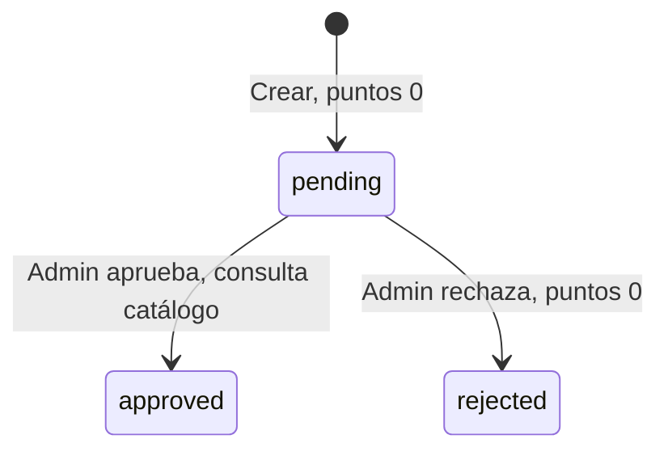

# Reglas de negocio y backend

[Índice](00-INDICE.md)

## Servidor y persistencia

Express monta CORS configurado por S02, JSON, routers y manejador final controlado. S04–S07 eliminan express.static de uploads; todos los archivos se sirven por ID y relación con BD. No se cambia CORS dentro de este bloque.

`pg.Pool` usa la configuración pura de databaseOptions.js: DATABASE_URL no vacía prevalece sobre DB_HOST/DB_PORT/DB_USER/DB_PASSWORD/DB_NAME; puerto predeterminado 5432. DB_SSL=false por defecto o true con verificación de certificado. No se alteraron tamaño/tiempos del pool. `query` delega directamente. Las consultas usan placeholders para valores de usuario; no hay ORM, capa de servicios ni sistema de migraciones.

## Autenticación y roles

Login busca email exacto, exige is_active, compara bcrypt y firma JWT por ocho horas. Crear usuario utiliza costo bcrypt 10 y guarda únicamente password_hash. El token identifica usuario y versión de sesión; el middleware obtiene equipo y rol actuales de PostgreSQL.

Desde S01, cada solicitud protegida consulta el usuario actual: existencia, is_active, role, team_id y versión de sesión. Desactivar rechaza el siguiente request; cambiar equipo afecta solicitudes nuevas sin reescribir históricos. F15 no permite editar el rol; si cambia por administración SQL autorizada, el backend usa el rol actual. El JWT HS256 dura ocho horas y lleva id/sv/iat/exp. /me reutiliza la consulta; no se exponen hash, is_active ni session_version. Logout elimina el token local, sin revocar copias; reset F16 incrementa session_version transaccionalmente y revoca sesiones anteriores. No hay registro público, refresh ni MFA.

## Autorización de creación — F11

Solo el líder registra reciclaje, conforme al README (registro por líderes), manual de líder y alta administrativa que asigna equipo solo a líderes. No existe rol supervisor, ni registro administrativo en nombre de otro equipo. POST /recycling aplica authorizeRoles('leader') antes del upload; admin y otros roles reciben 403 incluso si poseen team_id. Los permisos de otros endpoints se conservan.

createRecord toma team_id de req.user actualizado por S01, nunca del body ni de claims obsoletos. Rechaza 403 si falta o no es entero positivo dentro del rango INT, y comprueba que exista con SELECT id FROM teams WHERE id=$1 FOR KEY SHARE dentro de la transacción, después del bloqueo de periods de F10 y antes del INSERT. Equipo inexistente también devuelve 403 y ROLLBACK. El bloqueo de clave protege la existencia hasta confirmar; NOT NULL/FK actúan como defensa adicional. F11 conserva las validaciones de equipo; S01 actualiza la autoridad de req.user sin modificar registros históricos.

Frontend restringe /leader/register a leader; navegación directa de admin/otros usa el redirect existente a /. El panel /leader conserva su acceso anterior leader/admin, pero solo muestra el enlace de registro al líder. Las pantallas administrativas y su navegación no ofrecen registro en nombre de equipos.

## Cupo de usuarios — F12

Máximo 15 cuentas totales almacenadas en users para toda la aplicación, incluidos administradores e inactivos. La evidencia es MAX_USERS=15, totalUsers=users.length sobre GET /admin/users sin filtros, y el manual que especifica cuentas totales. No es un límite de líderes, activos, por equipo, por período ni acumulado histórico de altas. Desactivar/reactivar no libera/consume cupo; no hay rutas para ello ni eliminación física en la aplicación. Un admin puede crear otro admin o un líder.

createUser conserva bcrypt 10, password_hash, cuenta activa y asignación de equipo según rol. Calcula el hash antes de BEGIN y toma LOCK TABLE users IN SHARE ROW EXCLUSIVE MODE antes de COUNT(*) e INSERT. Mantiene el bloqueo hasta COMMIT/ROLLBACK; libera la conexión en finally y la descarta si falla rollback. El bloqueo solo afecta escritores de users, permite lectores y evita una clave advisory que otro escritor del repositorio pudiera omitir. No se bloquean periods ni recycling_records; la comprobación FK de equipo mantiene el orden users antes de la referencia. Las lecturas/FK de F08–F11 no requieren ese bloqueo de escritura. Dos altas concurrentes no consumen el mismo cupo.

database/create_admin.sql, la otra vía de alta incluida en el repositorio, utiliza la misma transacción, bloqueo y comprobación. Los seeds no crean usuarios. No se añadió migración ni constraint: la garantía cubre API y bootstrap controlado; SQL administrativo arbitrario aún puede superar el límite si omite la comprobación. Un estado previo con más de 15 no se corrige ni pierde datos: nuevas altas se rechazan. El límite es 409/USER_LIMIT_REACHED por API y aborto explícito por psql. Errores internos de createUser son 500 genéricos sin SQL.

## Ciclo de registro



La UI muestra acciones solo en pendientes; la API exige pending bajo bloqueo de fila dentro de una transacción PostgreSQL. Las revisiones posteriores devuelven 409. Guarda una decisión con reviewed_by, reviewed_at y review_notes; no hay historial inmutable. Al crear verifica la relación vigente entre material, cantidad y catálogo. F10 exige un activo y coincidencia del period_id recibido con el consultado, y valida record_date como fecha de realización de la actividad, dentro del rango inclusivo del activo y no futura.

F10 adquiere LOCK TABLE periods IN SHARE MODE antes de leer el activo e insertar el registro, y mantiene el bloqueo hasta COMMIT/ROLLBACK. Permite altas simultáneas y es incompatible con el SHARE ROW EXCLUSIVE de F09. Ambos flujos toman primero el bloqueo de periods antes de sus escrituras; F10 no intenta convertirlo en un bloqueo de escritura de periods. Si el alta obtiene el bloqueo primero, se confirma con el activo anterior y luego F09 puede sustituirlo; si F09 llega primero, el alta lee el nuevo activo y rechaza un ID obsoleto. No se cambia F09 ni se exige que un registro histórico permanezca asociado a un período activo para siempre.

record_date representa la fecha en que se realizó la actividad de reciclaje reportada. Se valida YYYY-MM-DD y calendario gregoriano, incluidos bisiestos, sin usar Date de Node. La regla autorizada es `start_date <= record_date <= end_date` y `record_date <= CURRENT_DATE`. Se comprueba con BETWEEN inclusivo y comparación DATE en PostgreSQL, dentro de la transacción, antes del INSERT. Se admite actividad pasada dentro del activo; se rechaza 400 fuera del rango o futura, aun si cae dentro del período. El fin se admite únicamente si no es futuro. Si está omitida/null/vacía se usa CURRENT_DATE, sometido también al rango. PostgreSQL determina el día según la transacción y su zona de sesión. El formulario conserva la sugerencia local y la edición; el backend es la autoridad y no utiliza conversiones UTC/timestamp.

## Puntuación vigente

Al aprobar, el backend busca un catálogo que coincida con:

```text
LOWER(TRIM(group_name)) = grupo del registro normalizado
LOWER(TRIM(action_name)) = acción del registro normalizada
LOWER(TRIM(COALESCE(action_level, ''))) = nivel normalizado o vacío
```

Se usa la primera fila por id ASC. Sin grupo/acción o sin coincidencia devuelve **0**, sin error. Rechazo siempre devuelve 0. No multiplica por cantidad, calidad ni criterios; la cantidad solo influye en la referencia derivada por frontend y backend.

Referencias enviadas por RegisterRecyclingPage, siempre grupo `Dependencias institucionales`:

| Condición de interfaz | Acción | Nivel exacto |
| --- | --- | --- |
| material organico, cualquier cantidad aceptada | Ciclo orgánico | 5 kg de abono generado en compostera |
| Otros materiales, cantidad <= 5 | Entrega acopio | Nivel 1: Volumen bajo (1 a 5 kg) |
| Otros, > 5 y <= 15 | Entrega acopio | Nivel 2: Volumen medio (6 a 15 kg) |
| Otros, > 15 y <= 30 | Entrega acopio | Nivel 3: Volumen alto (16 a 30 kg) |
| Otros, > 30 | Entrega acopio | Nivel 4: Volumen masivo (+30 kg) |

La interfaz admite decimales: 5.1 corresponde al segundo nivel aunque el texto diga 6. Para orgánico no verifica que se hayan producido 5 kg de abono. Al crear, el backend reconstruye esta misma referencia desde `material_type` y `quantity`, exige que los tres textos recibidos coincidan y comprueba que la identidad exista en `points_catalog`. Guarda los textos canónicos del catálogo y rechaza con 400 una referencia manipulada o ausente.

El CSV distribuido no incluye ese grupo. Se necesitan valores institucionales aprobados y coherencia de catálogo antes de validar puntajes reales. En particular, un registro orgánico se rechaza si su identidad vigente no está configurada; la aplicación no inventa la fila ni sus puntos. Modificar catálogo no recalcula registros ya aprobados; F08 impide repetir su revisión por API.

## Metadatos no automatizados del catálogo

Las 56 filas tienen instrucciones no vacías en `evidence_required`: incluyen una o varias fotos, videos, enlaces, GPS, documentos, autodeclaraciones y validaciones por sistema o historial. Un archivo presente no demuestra por sí solo esas condiciones. La evidencia del formulario sigue siendo opcional y el administrador la revisa manualmente.

`max_frequency` contiene diez textos: `Ilimitado` (38 filas), `Mensual` (5), `Semanal` (3), `Trimestral` (3), `1 por visita` (2), y una fila para cada uno de `2 al mes`, `2 por semana`, `3 por semana`, `Semestral` y `Única vez`. El repositorio no define inicio de ventanas, zona horaria, sujeto del conteo, significado de visita ni tratamiento de revisiones repetidas. Tampoco existe estado o algoritmo de rachas; las palabras “racha” e “historial” son parte descriptiva de algunas filas.

Por tanto, `evidence_required` y `max_frequency` se exponen únicamente como información. No intervienen en creación, revisión, aprobación ni puntuación. Automatizarlos requiere reglas institucionales estructuradas; no se infieren algoritmos desde esos textos.

## Ambigüedades de cantidad y orgánico

Los niveles son textos descriptivos, no columnas numéricas de mínimo/máximo. El comportamiento heredado conserva `q <= 5`, `5 < q <= 15`, `15 < q <= 30` y `q > 30`. Por ello 5.1–5.9 entra al nivel rotulado “6 a 15 kg” y 15.1–15.9 al rotulado “16 a 30 kg”. El `step="0.1"` permite precisamente esos valores. No hay evidencia para redondear, prohibir decimales o cambiar los límites.

Para orgánico, “5 kg de abono generado en compostera” no especifica si se trata de cantidad exacta, umbral mínimo, bloque acumulable, frecuencia o simple descripción. La única fila similar pertenece a `Hogares`, no a `Dependencias institucionales`, por lo que sus 40 puntos no se reutilizan. Hasta recibir definición y catálogo institucional autorizados, la referencia orgánica no puede crearse con la protección F05 activa.

## Fuente única de puntos

F04 retiró la utilidad obsoleta `calculatePoints.js`, que no tenía imports ni participaba en rutas. La única fuente ejecutable es `points_catalog.points`: `reviewRecord` la consulta al aprobar y guarda el resultado en `recycling_records.points_awarded`. El registro nace con cero, el rechazo asigna cero y el ranking suma `points_awarded` de aprobados del periodo activo. `quality_level` y `criteria_count` se conservan como información del registro, pero no intervienen en este cálculo.

## Ranking y periodos

Ranking elige periodo is_active por fecha inicial DESC e id DESC, sin comprobar que hoy esté dentro de las fechas. Sin activo devuelve ranking vacío. Incluye todos los equipos con suma de aprobados del periodo; empates por nombre y posiciones consecutivas, no compartidas.

F09 conserva la regla de máximo un período activo, con cero permitido. Crear uno activo desactiva todos y luego inserta en una conexión dedicada: BEGIN, LOCK TABLE periods IN SHARE ROW EXCLUSIVE MODE, UPDATE, INSERT, COMMIT. El bloqueo serializa escritores incluso con tabla vacía, evita carreras sin depender de que exista una fila activa y permite SELECT ordinarios. Se eligió junto con un índice único parcial: el bloqueo coordina el reemplazo y el índice impide múltiples activos incluso en escrituras externas que no sigan el controlador. Como contrapartida, las creaciones inactivas también esperan a otros escritores de periods; es una operación administrativa breve. Ante fallo se ejecuta ROLLBACK y se conserva el anterior. Los consumidores ven el estado confirmado anterior o posterior, sin la desactivación intermedia. No hay activación de existentes ni desactivación independiente. Premios y ganadores no forman parte de la API actual; sus tablas históricas no participan en este cálculo.

## Estadísticas e indicadores

F13 define reciclaje aprobado como registros con `status = 'approved'`. Las sumas denominadas kg (`general.total_quantity`, `materials[].total_quantity`) aplican además `lower(btrim(unit)) = 'kg'`. Pending/rejected y cualquier otra unidad quedan fuera de esas cantidades, sin alterar registros ni convertir unidades. Los conteos operativos y las sumas de puntos conservan su contrato anterior: actividad de todos los estados, independiente de la unidad.

`quantity` es NUMERIC(10,2), cantidad positiva en la unidad declarada por separado en `unit` (texto libre, predeterminado kg). Esto se aplica a papel/cartón, plástico, vidrio, metal y orgánico, los únicos materiales admitidos por esquema y F05. El formulario etiqueta por separado Cantidad y Unidad; no impone kg. El manual recomienda kg, pero no demuestra que toda fila lo use. Por tanto, cada uno de los cinco materiales entra al total únicamente si su fila declara kg; `KG` y espacios exteriores se normalizan solo para comparar. Litros, unidades, bloques, gramos, toneladas, unidad vacía/desconocida y otros textos quedan excluidos, sin equivalencias inventadas.

En orgánico no se deducen kg desde “5 kg de abono generado en compostera”, ni se multiplica quantity por 5, ni se presume que representa bloques. Una fila orgánica aprobada con unit kg aporta exactamente su quantity declarada; una con unit bloques no aporta kg. Esto no valida la metodología orgánica ni cambia F05/F07: la falta de catálogo institucional sigue bloqueando las altas correspondientes y requiere su decisión independiente. El CSV contiene actividades en litros, unidades y kg de otros grupos, pero no una tabla de conversión de recycling_records. Seeds no aportan registros de negocio; las pruebas anteriores en kg son fixtures, no evidencia sobre datos reales.

Alcance histórico: general, materiales, equipos incluyen todos los períodos y filas sin período. periods agrupa por período existente; no hay filtro de activo. El dashboard administrativo consume `/public/stats`, por lo que comparte exactamente la base pública. `GET /admin/dashboard` y los conteos personales siguen mostrando actividad, no kg. El ranking mantiene aprobados del período activo; no se modifica su SQL ni la puntuación. Excel conserva filas de todos los estados con cantidad/unidad separadas, sin sumatoria.

## Metodología de indicadores ambientales

F14 CORREGIDO por retiro autorizado de las cuatro equivalencias sin respaldo suficiente. No significa validación de factores. Se eliminaron environmentalIndicators.js, su importación/cálculo y el objeto indicators de /public/stats. Tampoco se recuperan las fórmulas preliminares.

El único indicador cuantitativo ambiental es **Cantidad total reciclada aprobada (kg)**: general.total_quantity, calculado con COALESCE(SUM(quantity) FILTER (WHERE status = 'approved' AND lower(btrim(unit)) = 'kg'), 0). Se conservan decimales NUMERIC y el histórico F13. Los subtotales por material, conteos y puntos permanecen. No se duplica el total en JavaScript.

La [metodología histórica](12-METODOLOGIA-INDICADORES.md) conserva factores retirados, origen git, fuentes evaluadas y razones de insuficiencia. Reintroducir equivalencias exige material específico, unidad, factor, fuente técnica y ubicación exacta, escenario de comparación, conversión reproducible y aplicabilidad a Ecoamigos. WARM distingue materiales y escenarios; no es un factor genérico por kg.

## Alcance de mantenimiento administrativo — F15

La decisión funcional autorizada completa la auditoría inicial: usuarios permiten crear/listar/editar nombre, email y equipo, y activar/desactivar; equipos permiten crear/listar/editar nombre y dependencia. No hay cambio de rol, clave ni borrado físico en F15. No se añaden migraciones ni campos a teams.

Desactivar cambia users.is_active sin borrar la fila. Login ya rechaza inactivos con 401. F12 cuenta todas las filas, incluidos administradores e inactivos, hasta quince; editar o reactivar no consume ni libera cupos. users.team_id cambia solo la asignación actual del líder; recycling_records.team_id conserva el equipo original. Un administrador permanece sin equipo, conforme al alta existente.

Desde S01, cada solicitud protegida consulta el usuario actual: existencia, is_active, role, team_id y versión de sesión. Desactivar rechaza el siguiente request; cambiar equipo afecta solicitudes nuevas sin reescribir históricos. F15 no permite editar el rol; si cambia por administración SQL autorizada, el backend usa el rol actual. F15 conserva sus campos autorizados; no se implementa edición de rol.

Se preservan IDs y referencias: RR.user_id/team_id son CASCADE al borrar, RR.reviewed_by y content_items.created_by SET NULL; users.team_id SET NULL al borrar equipo. RR.period_id es SET NULL y winner_records conserva CASCADE legado para períodos/equipos. Estos riesgos justifican no habilitar DELETE. Las FK no prohíben modificaciones SQL externas: la protección aquí corresponde a rutas de aplicación, no a una política institucional inventada de retención.

Períodos con registros se tratan como históricos: no se permite editar sus fechas ni eliminarlos. Tampoco se habilita edición de períodos vacíos porque no hay necesidad demostrada; creación/listado cubren el flujo actual. F09 conserva máximo un activo (cero permitido) y rollback del anterior; F10 sigue validando período activo y fecha al registrar. No se habilita activación independiente de períodos existentes.

Renombrar usuarios/equipos cambia las etiquetas obtenidas mediante JOIN, no sus IDs ni registros anteriores. Ranking conserva algoritmo y puntos; al renombrar equipos empatados puede cambiar el desempate alfabético existente. No se reescribe historia ni se agrega versionado de nombres. D01 conserva teams.leader_id si existe como legado distinto de users.team_id; no hay reasignación automática.

## Archivos

| Aspecto | Evidencias | Contenidos |
| --- | --- | --- |
| Campo multipart | evidence | file |
| Ubicación | UPLOAD_ROOT/managed/evidence | UPLOAD_ROOT/managed/content |
| Creación de carpeta | Automática al recibir carga | Automática al recibir carga |
| Nombre | UUID + extensión canónica | UUID + extensión canónica |
| Límite | Imágenes 10 MiB; techo evidencia 20 MiB | Imagen 10 MiB, documento 20 MiB, video 100 MiB |
| Filtro | Extensión + MIME + firma, imágenes/videos permitidos | Igual, más PDF/DOCX |
| Acceso | Admin o líder propietario por endpoint | Publicado público por ID; borrador solo admin |

Multer escribe en área privada antes del controlador. La validación real antecede SQL; archivos nuevos rechazados se retiran. El helper comprueba ambas relaciones antes de eliminar, conservando el archivo ante fallo de BD. No hay antivirus ni certificación de validez completa; la detección de firma y cierres básicos no demuestra contenido benigno.

## Exportación Excel

GET admin/export/excel requiere admin. Consulta registros con usuario/equipo existentes y periodo opcional, orden record_date DESC, con LIMIT parametrizado igual a EXPORT_MAX_ROWS + 1. Crea libro en memoria con autor Ecoamigos, compañía institucional y fecha actual; una hoja “Reporte Ecoamigos”.

Columnas: Fecha, Líder, Equipo, Material, Cantidad, Unidad, Estado, Puntos, Período. Encabezado verde #71B956 con texto blanco, filtro A1:I1 y primera fila inmovilizada. Descarga Reporte_Ecoamigos.xlsx. No incluye evidencia, criterios, catálogo ni comentarios; no tiene filtros ni varias hojas. El volumen aumenta uso de memoria y duración dentro del límite técnico configurable. Si excede el máximo, no se construye libro. Una generación por proceso, liberada en finally ante éxito/error SQL/error XLSX. Texto de usuario se convierte a string XLSX, nunca a objeto formula; valores numéricos existentes no se prefijan ni alteran. Esto no es una protección de futuras conversiones a CSV.

## Logs y gestión de errores

`logger.js` escribe eventos técnicos JSONL mediante una cola asíncrona acotada, en LOG_DIR, con tamaño y retención configurables. Solo conserva evento definido, nivel, fecha ISO, IDs numéricos admitidos y estado approved/rejected; descarta datos libres, anidados, errores completos y secretos. Los controladores ya no adjuntan error.message SQL a respuestas; los mensajes funcionales controlados se conservan. Exportación usa evento EXPORT_ERROR. No es auditoría inmutable: reviewed_by/reviewed_at/review_notes siguen en PostgreSQL sin cambios. Detalles y limitaciones en 08-OPERACION.


## Recuperación temporal — F16

Auditoría: users.password_hash es autoritativo tras D01/D02; login usa bcrypt.compare y el alta bcrypt.hash(...,10), sin política fuerte de longitud/complejidad. La columna password heredada no se consulta ni escribe. No hay servicio de correo, rate limit ni revocación de JWT configurados. No se modifica D01, roles, F15 ni credenciales administrativas.

password_reset_tokens contiene id, user_id (FK ON DELETE RESTRICT), token_hash UNIQUE con formato SHA-256 hexadecimal, expires_at, used_at y created_at (TIMESTAMPTZ). Un índice user_id facilita invalidar tokens de la cuenta. No almacena texto plano del token ni contraseña nueva. La FK impide cascadas sobre recuperación; no introduce borrado de historial. No se añade purga automática ni política de retención no autorizada.

crypto.randomBytes(32) aporta 256 bits de entropía; SHA-256 permite lookup de un secreto aleatorio, no sustituye bcrypt para contraseñas. Vigencia fija de 30 minutos: limita exposición del enlace y deja tiempo para recibirlo/usarlo. Nueva solicitud marca usados los enlaces anteriores de la cuenta. El adaptador recibe email, token y expiración solo después del COMMIT, sin registrar secretos ni devolverlos por HTTP.

Solicitud y reset bloquean primero users FOR UPDATE; reset después bloquea el token. Esto serializa solicitudes, consumo simultáneo y cambios F15 de la misma cuenta, sin invertir bloqueos entre distintos tokens. Reset verifica cuenta activa, hash, used_at y expiración; calcula bcrypt costo 10, vuelve a comprobar vigencia con clock_timestamp(), consume token, actualiza únicamente password_hash e invalida pendientes, todo en una transacción. Cualquier fallo, incluido COMMIT, revierte hash/consumo. El cliente se libera o descarta si falla rollback. Cero cambios en referencias, cupo F12, períodos, puntos o ranking.

La nueva clave requiere entre 1 y 72 bytes UTF-8, sin regla de complejidad adicional. El límite superior evita truncamiento silencioso de bcrypt; endurecer el mínimo del alta/recuperación corresponde a seguridad y se documenta pendiente.

La entrega automática de correo requiere un adaptador institucional posterior. passwordResetDelivery.js deja una interfaz explícita, devuelve false mientras no haya proveedor y ofrece construcción del enlace con CLIENT_URL (HTTPS en producción). No lee credenciales de correo ni imprime enlaces. Solo pruebas inyectan un capturador en memoria; no hay interruptor de entorno para exponer tokens.

S01: recuperar incrementa session_version y revoca JWT anteriores. S02 permanece parcial por almacenamiento local accesible a JavaScript. S03 aplica límites por IP a login/solicitud/reset; sus parámetros y limitaciones constan en Operación. Respuestas genéricas eliminan distinción explícita de cuenta, no garantizan tiempo constante. Fallos de emisión/entrega también son genéricos para no revelar existencia; observabilidad institucional futura debe excluir email/token/clave y detalles sensibles.


### Reglas vigentes de archivos

JPEG/JPG (image/jpeg), PNG (image/png), WEBP (image/webp), MP4 (video/mp4), MOV (video/quicktime) y AVI (video/x-msvideo, video/avi, video/msvideo o video/vnd.avi). Contenido admite además PDF (application/pdf) y DOCX (application/vnd.openxmlformats-officedocument.wordprocessingml.document). No se admiten nuevas cargas DOC, SVG, GIF, ejecutables ni extensiones fuera de esta lista.

Límites técnicos configurables, no política institucional: imágenes 10 MiB, documentos 20 MiB y videos de contenido 100 MiB; evidencia conserva techo total de 20 MiB (imágenes hasta 10 MiB). Un archivo por solicitud, 24 campos de hasta 64 KiB y 25 partes multipart. Nombres UUID generados por servidor con extensión canónica, escritura exclusiva sin sobrescritura.

Crear: fallo SQL o validación funcional retira el nuevo archivo si no está referenciado. Reemplazar: FOR UPDATE serializa la fila; rollback conserva anterior y retira nuevo. Tras COMMIT se libera la conexión y se comprueban referencias antes de borrar anterior. DELETE de contenido toma el mismo bloqueo, confirma y limpia; no se añade DELETE de evidencias. La comprobación incluye content_items.file_url y recycling_records.evidence_url para proteger referencias compartidas/heredadas.

Los errores de cleanup generan FILE_CLEANUP_PENDING sin rutas/SQL/secretos. Si BD no puede confirmar ausencia de referencias, se retiene. No se reporta fracaso de una mutación ya confirmada por fallar unlink. Disco y BD no constituyen una transacción distribuida: una caída entre escritura y cleanup puede dejar residuos; la política de revisión está en Operación.
